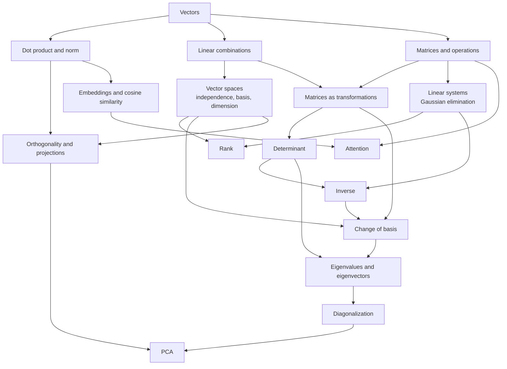
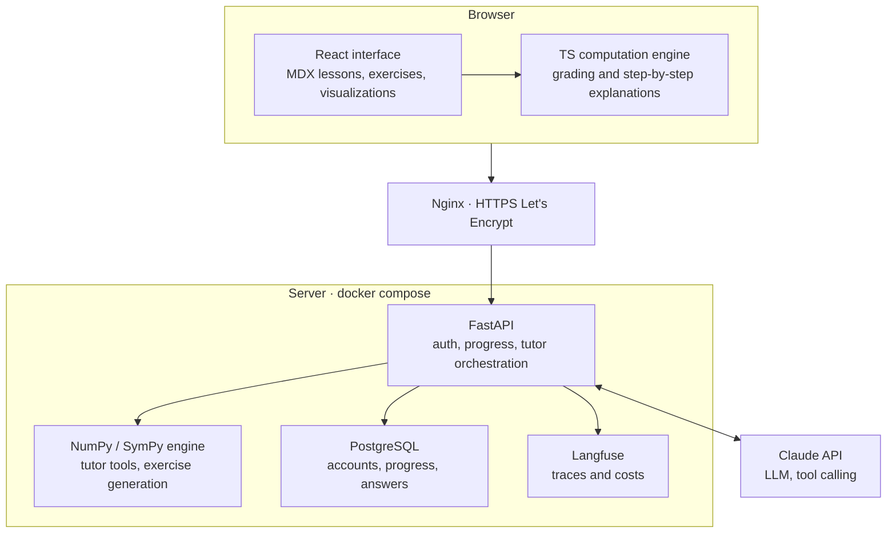

# Interactive Linear Algebra

A learning platform for understanding linear algebra in depth: progressive lessons, automatically graded exercises, step-by-step explanations of every computation, and interactive visualizations to build intuition. An AI tutor, grounded in an exact computation engine, supports learners when they get stuck.

## Vision

Understanding linear algebra means knowing **why** an operation works, not just **how** to carry it out. The platform rests on four pillars:

- **Lessons**: each concept is introduced simply, motivated by an example, then formalized.
- **Exercises**: understanding comes through practice; every answer is graded, and every common mistake gets a targeted explanation.
- **Step-by-step explanations**: every computation (matrix product, determinant, Gaussian elimination…) can be unfolded one step at a time.
- **Visualizations**: in service of understanding, built into lessons and exercises, never an end in themselves.

One cross-cutting principle: **the engine computes, the LLM explains**. No numerical result and no solution ever comes from a language model.

## Learning content

The content is not a linear sequence of chapters but a **graph of concepts**. Each concept declares its prerequisites; once vectors are mastered, learners can move on to matrices, vector spaces or the dot product, depending on their curiosity or needs.

| Concept                          | Prerequisites                           | Content                                                                  |
| -------------------------------- | --------------------------------------- | ------------------------------------------------------------------------ |
| Vectors                          | none                                    | Definition, representation, addition, scalar multiplication              |
| Dot product and norm             | Vectors                                 | Norm, distance, dot product, angle between two vectors                   |
| Linear combinations              | Vectors                                 | Combinations, span, geometric interpretation                             |
| Matrices and operations          | Vectors                                 | Definition, addition, matrix product, transpose                          |
| Vector spaces                    | Linear combinations                     | Linear independence, basis, dimension, subspaces                         |
| Matrices as transformations      | Matrices, Linear combinations           | Rotations, scalings, projections, composition                            |
| Linear systems                   | Matrices                                | Matrix form, Gaussian elimination, existence and uniqueness of solutions |
| Rank                             | Linear systems, Vector spaces           | Rank, kernel, image, rank–nullity theorem                                |
| Determinant                      | Matrices as transformations             | Signed area and volume, computation, singular matrices                   |
| Inverse                          | Linear systems, Determinant             | Invertibility, computation by elimination, geometric interpretation      |
| Change of basis                  | Vector spaces, Transformations, Inverse | Change-of-basis matrices, similar matrices                               |
| Orthogonality and projections    | Dot product, Vector spaces              | Orthonormal bases, orthogonal projection, Gram–Schmidt                   |
| Eigenvalues and eigenvectors     | Determinant, Change of basis            | Invariant directions, characteristic polynomial                          |
| Diagonalization                  | Eigenvalues and eigenvectors            | Conditions, computation, matrix powers                                   |
| PCA                              | Diagonalization, Orthogonality          | Covariance matrix, dimensionality reduction                              |
| Embeddings and cosine similarity | Dot product                             | Vector representations of words, similarity search                       |
| Attention                        | Embeddings, Matrices                    | Queries, keys, values: attention as a matrix product                     |

Each concept is made of lessons, exercises and a summary. Prerequisites are **recommended, not blocking**: the interface flags a concept whose prerequisites have not yet been completed and suggests reviewing them, without preventing access. An interactive map of the graph shows learners what they have mastered and what is now open to them.

On the content side, the graph is described in the files themselves: each concept declares its prerequisites in the front matter of its MDX file (`requires: [vectors, matrices]`). CI checks that the graph has no cycles and that every referenced prerequisite exists.

Exercise types:

- **Computation**: numerical, vector or matrix answer, checked by the engine (explicit tolerances, fractions accepted).
- **Understanding**: multiple-choice questions on concepts, with an explanation for each wrong answer.
- **Manipulation**: place a vector, build a matrix that performs a given transformation.
- **Step by step**: learners carry out a computation themselves (Gaussian elimination, determinant), with feedback at each step.

Each exercise offers progressive hints and a detailed solution generated from the computation engine.

## Scope and principles

Every iteration ends with a production release, however minimal: nothing stays "almost done" on a branch.

- **Understanding first**: a feature only gets in if it helps understand a concept.
- **Ship early, ship often**: the CI/CD pipeline exists before the first feature.
- **The engine computes, the LLM explains**: grading and solutions always come from the engine.
- **Tested where it matters**: the computation engine and the exercise grader are covered by tests from day one.
- **Small but polished**: a few complete, correct concepts beat an entire graph done approximately.

Out of scope for now: Kubernetes, native mobile app, multi-role accounts (teacher / student), visualizing matrices larger than 4×4.

## Tech stack

TypeScript on the front end, Python (FastAPI) on the back end: the best trade-off between an interactive interface and the AI ecosystem.

| Layer              | Choice                          | Why                                                                                                                                  |
| ------------------ | ------------------------------- | ------------------------------------------------------------------------------------------------------------------------------------ |
| Front end          | React + TypeScript + Vite       | Industry standard, strict typing, fast builds                                                                                        |
| Lesson content     | MDX versioned in the repository | Written in Markdown, interactive components embedded in lessons, prerequisites declared in front matter, reviewed via merge requests |
| Concept map        | React Flow (or custom SVG)      | Interactive display of the dependency graph and progress                                                                             |
| Math notation      | KaTeX                           | Fast formula rendering, LaTeX syntax                                                                                                 |
| Visualizations     | SVG (canvas later if needed)    | Easy to animate and test; Three.js later for 3D                                                                                      |
| Computation engine | Dedicated TypeScript module     | Instant client-side grading, step-by-step explanations, no latency                                                                   |
| Back end           | Python + FastAPI                | Typing with Pydantic, generated OpenAPI, native LLM ecosystem                                                                        |
| Server-side engine | NumPy / SymPy                   | Source of truth for the tutor and exercise generation; validated against the TS engine                                               |
| Database           | PostgreSQL                      | Accounts, progress, answer history, traces                                                                                           |
| LLM                | Claude API with tool calling    | Reliable tool calls, streaming                                                                                                       |
| Tests              | Vitest, Pytest, Playwright      | Front-end and back-end unit tests, end-to-end tests                                                                                  |

**Open decision**: keep two engines (TS on the client, NumPy on the server) or a single server-side one. Two engines allow instant grading without network calls, at the cost of a cross-testing suite that guarantees they produce the same results.

## Architecture

Lessons, exercise grading and visualizations run in the browser; the server handles accounts, progress and the AI tutor.

When a learner asks the tutor a question, FastAPI sends the LLM the context (current lesson, exercise, answer given) and the list of available tools; the LLM requests computations from the engine, then writes its explanation from the exact results. Every exchange is traced in Langfuse.

## Infrastructure and CI/CD

GitLab is the source of truth and drives all deployments; a push mirror publishes the repository on GitHub.

GitLab CI pipeline, in order:

1. **Lint**: ESLint + Prettier (front end and MDX content), Ruff (back end).
2. **Tests**: Vitest, Pytest, content validation (acyclic graph, existing prerequisites, every solution recomputed by the engine); Playwright from V1 onward.
3. **Build**: one Docker image per service, pushed to the GitLab registry.
4. **Staging**: automatic deployment on every merge to `main`.
5. **Production**: deployment on a `vX.Y.Z` tag, with manual approval.

| Component                     | Tool                                                       |
| ----------------------------- | ---------------------------------------------------------- |
| Containers                    | Docker + docker compose                                    |
| Reverse proxy and HTTPS       | Nginx + Certbot (Let's Encrypt, automatic renewal)         |
| Server provisioning           | Ansible                                                    |
| Secrets                       | Protected GitLab CI variables, `.env` file never committed |
| Front-end and back-end errors | Sentry                                                     |
| Uptime                        | Uptime Kuma                                                |
| LLM traces, costs, latency    | Self-hosted Langfuse (from V3 onward)                      |
| Backups                       | Daily PostgreSQL dump to a second server                   |

On GitHub, a minimal Actions workflow (lint and tests) displays the build status.

## Roadmap

Six versions, each usable on its own and deployed to production before the next one starts.

| Version | Theme                                     | Deliverable                                                                                                                                   | Done when                                                                          |
| ------- | ----------------------------------------- | --------------------------------------------------------------------------------------------------------------------------------------------- | ---------------------------------------------------------------------------------- |
| V0      | Delivery pipeline                         | A sample MDX lesson with KaTeX formulas, and `/health` over HTTPS, deployed by the pipeline                                                   | A commit to `main` reaches staging, the `v0.1.0` tag goes to production            |
| V1      | Graph root                                | Vectors, Dot product and Linear combinations: lessons, auto-graded exercises, embedded 2D visualization                                       | All three concepts can be followed end to end, graph and solutions validated in CI |
| V2      | Matrix branch, map and accounts           | Matrices, Transformations, Linear systems with step-by-step explanations; interactive concept map; accounts and per-concept progress          | Progress saved in PostgreSQL and shown on the map, backups in place                |
| V3      | AI tutor grounded in the engine           | Contextual tutor (lesson, exercise, answer), tool calling, streaming, Langfuse traces, rate limiting                                          | Eval suite in CI, no answer contradicts the engine                                 |
| V4      | Generated exercises and adaptive learning | Exercises generated and verified by the engine; the graph is used to recommend the next concept or a prerequisite to review based on mistakes | Every published solution is computed, never written by the model                   |
| V5      | Graph extension                           | Vector spaces, determinant, inverse, eigenvalues, then the AI branch (embeddings, attention, PCA)                                             | Optional: 3D visualizations with Three.js                                          |

## Milestones and guardrails

Each milestone is a verifiable criterion: until it is met, we do not move on to the next version.

| Milestone                           | Version | Verifiable criterion                                                                                   | Status   |
| ----------------------------------- | ------- | ------------------------------------------------------------------------------------------------------ | -------- |
| M1 · Working pipeline               | V0      | A commit to `main` reaches staging in under 10 minutes, with no manual step                            | ⬜ To do |
| M2 · Reproducible server            | V0      | A fresh server is ready in one command via the Ansible playbook, certificates included                 | ⬜ To do |
| M3 · Complete root                  | V1      | The three root concepts include their lessons, exercises and summary                                   | ⬜ To do |
| M4 · Reliable grading               | V1      | Engine and grader tests pass, edge cases covered (zero vector, fractions, rounding)                    | ⬜ To do |
| M5 · Verified understanding         | V1      | Someone outside the project follows the "Vectors" concept unaided and passes its summary exercises     | ⬜ To do |
| M6 · Map and accounts in production | V2      | Sign-up, login and progress work, the map reflects mastered concepts; a backup restore has been tested | ⬜ To do |
| M7 · Grounded tutor                 | V3      | Evals in CI: every numerical value in an answer comes from a tool call                                 | ⬜ To do |
| M8 · Controlled costs               | V3      | Cost per conversation measured in Langfuse, monthly cap and rate limiting active                       | ⬜ To do |
| M9 · Verified generated exercises   | V4      | No exercise is published without a solution computed by the engine                                     | ⬜ To do |
| M10 · Complete graph                | V5      | Every concept in the graph is live, with up-to-date architecture and decision documentation            | ⬜ To do |

At the end of each version, three questions:

1. Is it in production, reachable at the public URL?
2. Does a learner understand the concept better after using it?
3. Does the next task serve the current milestone? If not, it goes to the backlog.

If a version drags on, we cut its scope rather than extend it.

## Iteration 0: the pipeline before the features

Goal: a sample lesson and a `/health` endpoint over HTTPS, deployed by the pipeline, with no manual action on the server.

**Repository and tooling**

- [ ] Create the GitLab monorepo: `frontend/`, `backend/`, `content/`, `infra/`, `docs/`
- [ ] Set up the push mirror to GitHub
- [ ] Add linters, formatters and pre-commit hooks (front end, back end and content)
- [ ] Write this README: purpose, stack, link to the demo

**Application**

- [ ] Initialize the front end (Vite + React + TypeScript) with MDX and KaTeX rendering
- [ ] Write a sample lesson ("What is a vector?") with a formula, a simple exercise and its prerequisites front matter
- [ ] Write the graph validation script (no cycles, existing prerequisites) and wire it into CI
- [ ] Initialize the FastAPI back end with `/health` and a first Pytest test
- [ ] Write a multi-stage Dockerfile per service and a `docker-compose.yml`

**Infrastructure**

- [ ] Write the Ansible playbook: Docker, firewall, deploy user, SSH key
- [ ] Configure Nginx and obtain Let's Encrypt certificates (Certbot) for `staging.` and the main domain
- [ ] Write `.gitlab-ci.yml`: lint, tests, build, staging deploy on `main`, production on tag
- [ ] Hook Uptime Kuma up to both environments

Done when: a commit to `main` shows up in staging in under ten minutes, and the `v0.1.0` tag goes to production.

## Risks and mitigations

| Risk                                                            | Mitigation                                                                                                              |
| --------------------------------------------------------------- | ----------------------------------------------------------------------------------------------------------------------- |
| Scope creep, project never finished                             | Each version ships on its own; every new idea goes to the backlog, not into the current version                         |
| Writing content takes longer than expected                      | One concept at a time, starting from the root of the graph; shared lesson template, content reviewed via merge requests |
| Inconsistent graph (missing prerequisite, forgotten dependency) | Automatic validation in CI, graph review with every new concept                                                         |
| Error in a lesson or solution                                   | Solutions recomputed by the engine in CI, error reporting available from every lesson                                   |
| Time spent on infrastructure at the expense of content          | Iteration 0 time-boxed; no Kubernetes                                                                                   |
| Numerical errors (rounding, near-singularity)                   | Explicit tolerances, edge-case tests, fraction display where possible                                                   |
| The tutor contradicts the engine or hallucinates                | Results only via tools, automated evals in CI                                                                           |
| The tutor gives the answer instead of guiding                   | Pedagogical instructions for the tutor (hints before solutions), dedicated evals                                        |
| LLM API costs on a public demo                                  | Per-IP rate limiting, monthly cap, caching of frequent answers                                                          |
| Data loss                                                       | Daily backups tested by a monthly restore                                                                               |
